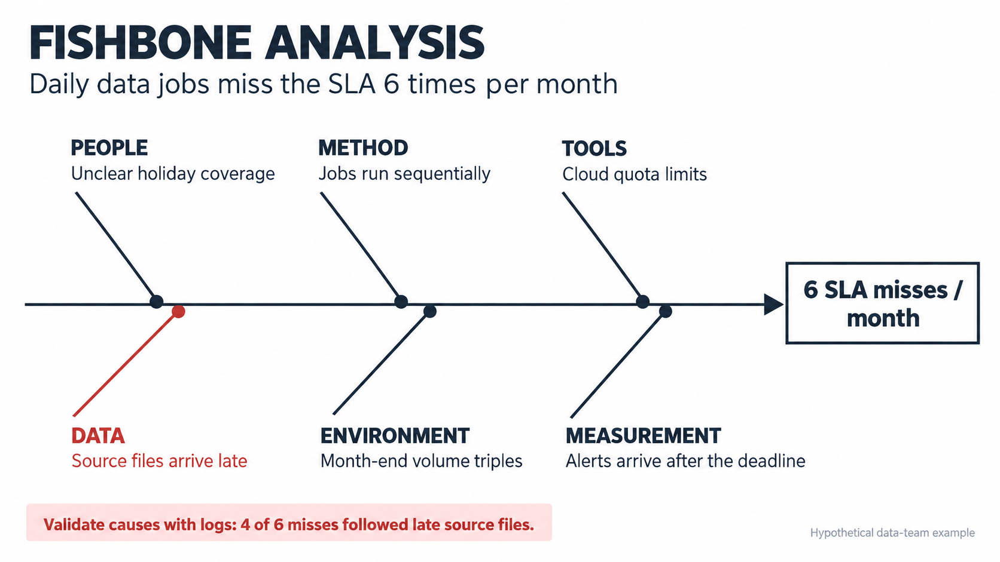
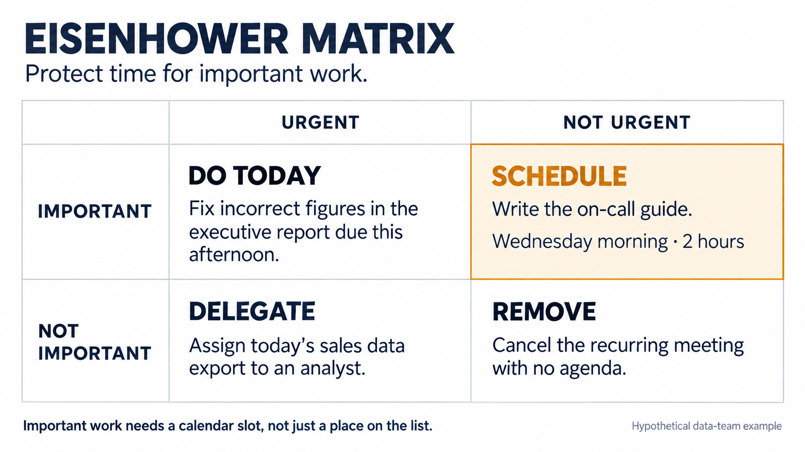
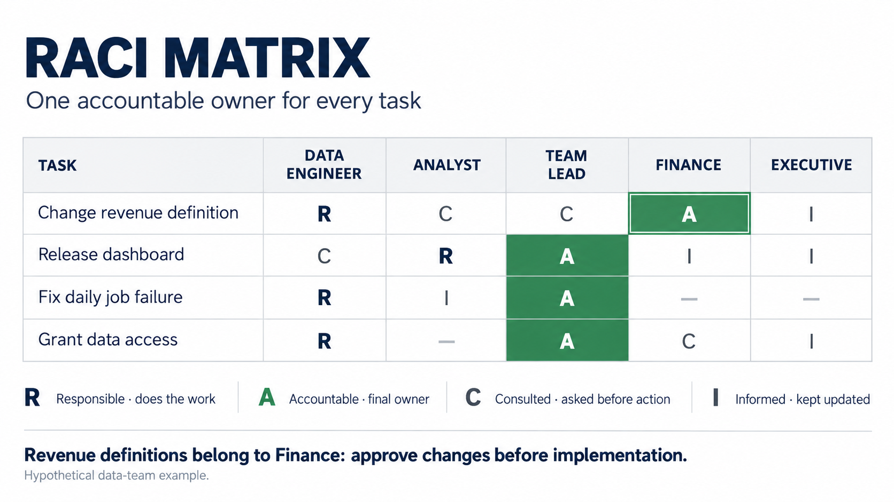

# ภาพต้นแบบ Framework

ภาพ static ที่สร้างผ่านเครื่องมือ imagegen ใน Codex session วันที่ 11 ต.ค. 2026 สำหรับส่งต่อการทำ UI; ไม่มีการเรียก API จากเว็บ และไม่ต้องมี API key ตอนเปิดเว็บ

## ภาพและสถานะ

| Framework | Minimal | ภาพแนวคิดชุดแรก |
|---|---|---|
| Fishbone | [minimal-v1.png](../../public/images/frameworks/fishbone/minimal-v1.png) | [illustrated-v1.png](../../public/images/frameworks/fishbone/illustrated-v1.png) |
| Eisenhower Matrix | [minimal-v1.png](../../public/images/frameworks/priority-matrix/minimal-v1.png) | [illustrated-v1.png](../../public/images/frameworks/priority-matrix/illustrated-v1.png) |
| RACI | [minimal-v1.png](../../public/images/frameworks/raci/minimal-v1.png) | [illustrated-v1.png](../../public/images/frameworks/raci/illustrated-v1.png) |

ทุกภาพมีสถานะ prototype; ชุด minimal ตรวจข้อความและโครงสร้างเทียบกับตัวอย่างสมมติเดิมแล้ว แต่ยังต้องให้เจ้าของประเมินหน้าจอจริง ชุด illustrated เก็บเพื่ออ้างอิงการเปรียบเทียบรูปแบบและยังไม่ควรเป็นค่าเริ่มต้น เพราะไม่แสดงข้อมูลเฉพาะของตัวอย่างครบ

## ข้อมูลสำหรับผู้พัฒนา

- `data/frameworks.json` เก็บ visuals เฉพาะ 3 framework; `lib/data.ts` ประกาศ FrameworkVisual แบบ optional
- `data/visual-prompts.json` เก็บ prompt แต่ละภาพ ใช้ promptId เชื่อมกลับไปจาก visuals
- src เป็น path ใต้ public เช่น /images/frameworks/raci/minimal-v1.png ไม่มี deployment base path; component ต้องเติม basePath ตาม lib/site.ts เพียงครั้งเดียว
- ทุกไฟล์ 1672×941 PNG มี alt/caption ไทยและข้อควรระวังใน contentNotes
- UI ยังไม่ได้ consume visuals; ขั้นต่อไปอยู่ใน [issue draft ของ visual tabs](issues/04-visual-tabs.md)
- ภาพสร้างใหม่โดยไม่มีภาพอ้างอิงภายนอก ไม่มีโลโก้หรือภาพจากหนังสือ ภาพเป็นตัวอย่างสมมติ ไม่ใช่ภาพหลักฐานกรณีศึกษาของบริษัทจริง; provenance ไม่ใช่การรับรองสถานะทางกฎหมายแบบอัตโนมัติ

## Style ของเว็บเดิม

อิง app/globals.css: --bg #f7f5ef, --paper #fff, --ink #1d2430, --ink2 #5a6270, --line #e2ded3; สีเน้น Fishbone --diag #b5322e, Eisenhower --dec #c7791a, RACI --exec #2b7a4b

ใช้พื้นเรียบ เส้นบาง hierarchy ชัด และสีเน้นเท่าที่จำเป็น ภาพ PNG มีพื้นสว่างคงที่ จึงต้องจัดพื้นที่แสดงภาพให้อ่านได้ใน dark mode โดยไม่กลับสี pixels ใช้ข้อความไทยใน HTML และตารางที่เข้าถึงได้ประกอบภาพภาษาอังกฤษ

## งานส่งต่อ

[รายการ issue drafts](issues/README.md) มีปัญหา หลักฐาน ขอบเขตและตรวจรับ ขณะเตรียมไฟล์นี้ GitHub connection ยังสร้าง issue ไม่ได้ (403 Resource not accessible by integration); ไฟล์เหล่านี้เป็น drafts ไม่ใช่ GitHub issue ที่เปิดแล้ว

